<a id="top"></a>

<div align="center">


# BhumiRadar | ভূমিরাডার

### স্মার্ট ভূমি প্রশাসন · রেকর্ড স্বচ্ছতা · ক্রিপ্টোগ্রাফিক নিরীক্ষা

**Satellite-aware land governance, cadastral discrepancy detection, litigation-aware registry locks and a tamper-evident cryptographic action ledger — for Bangladesh.**

<br/>

[](https://react.dev/)
[](https://www.typescriptlang.org/)
[](https://vitejs.dev/)
[](https://leafletjs.com/)
[](https://csrc.nist.gov/publications/detail/fips/180-4/final)
[](#-bilingual-by-design)
[](#-the-17-modules)
[](#-testing--validation)
[](LICENSE)

<br/>

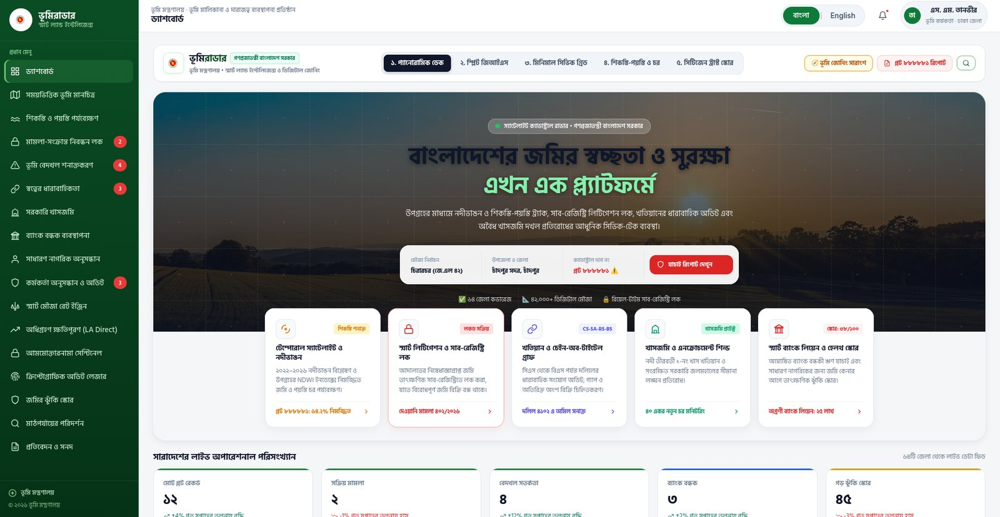

<sub><i>The BhumiRadar dashboard: one parcel-centric workspace for citizens, AC (Land), Sub-Registrars and LA Collectors.</i></sub>

</div>

---

## 📑 Table of Contents

<details open>
<summary><b>Click to collapse / expand</b></summary>

1. [Executive Overview](#-executive-overview)
2. [Problem Statement](#-problem-statement)
3. [The BhumiRadar Solution](#-the-bhumiradar-solution)
4. [The 17 Modules](#-the-17-modules)
5. [Product Tour (Screenshots)](#-product-tour)
6. [Roles & Personas](#-roles--personas)
7. [System Architecture](#-system-architecture)
8. [UML Diagrams](#-uml-diagrams)
   - [Use Case](#81-use-case-diagram) · [Class](#82-class-diagram--domain-model) · [Component](#83-component-diagram) · [Package](#84-package-diagram)
   - [Sequence Diagrams](#85-sequence-diagrams) · [Activity / Workflows](#86-activity--workflow-diagrams) · [State Machines](#87-state-machine-diagrams) · [ER Diagram](#88-entity-relationship-diagram)
9. [Data & Analytics Graphs](#-data--analytics-graphs)
10. [Cryptographic Action Ledger](#-cryptographic-action-ledger-deep-dive)
11. [Statutory Calculation Engines](#-statutory-calculation-engines)
12. [Technology Stack](#-technology-stack)
13. [Quick Start](#-quick-start)
14. [Configuration & Scripts](#-configuration--scripts)
15. [Testing & Validation](#-testing--validation)
16. [Project Structure](#-project-structure)
17. [Security, Privacy & Simulation Boundaries](#-security-privacy--simulation-boundaries)
18. [Companion Cadastral Data Platform](#-companion-cadastral-data-platform)
19. [Research Foundations](#-research-foundations)
20. [Roadmap](#-roadmap)
21. [Documentation Index](#-documentation-index)
22. [Contributing](#-contributing)
23. [Glossary](#-glossary)
24. [Legal Disclaimer & Acknowledgements](#-legal-disclaimer--acknowledgements)

</details>

---

## 🌟 Executive Overview

**BhumiRadar** (ভূমিরাডার) is a parcel-centric land governance and cadastral-transparency platform. It sits between citizens and the officers who administer land — *Sadharan Nagorik*, *Assistant Commissioner (Land)*, *Sub-Registrar*, *Additional Deputy Commissioner (LA)* and *Kanungo* — and gives all of them **one verifiable view of a plot**: who owns it, how that ownership evolved, whether it is protected, litigated, mortgaged, eroding or encroached, what it should cost to register, and what the state would owe if it were acquired.

It operationalises the rules of:

| Statute | What BhumiRadar encodes |
| :-- | :-- |
| **State Acquisition & Tenancy Act 1950 (SATA)** | Khas land, river diluvion (*sikosti*) and accretion (*poyosti / char*) ownership logic |
| **Acquisition & Requisition of Immovable Property Act 2017 (ARIPA)** | Compensation with statutory premium (200 % / 300 %) |
| **Power of Attorney Act 2012** | Registered PoA validity, revocation, expiry and scope checks |
| **Stamp Act 1899 · Registration Act · Income Tax Act 2023** | Stamp duty, registration fee, local-government tax, AIT (§ 53H) |
| **Civil Procedure Code (Order 39)** | Injunction / status-quo orders that freeze registration |

> **One idea underneath everything:** *every* consequential action — a lock, a valuation, a field report, a compensation award — is appended to a **SHA-256 hash-chained ledger**, so history cannot be quietly rewritten.

```text
                    ┌──────────────────────────────────────────────┐
                    │          BhumiRadar · Tripartite Value Loop   │
                    └───────────────────────┬──────────────────────┘
                                            │
          ┌─────────────────────────────────┼─────────────────────────────────┐
          ▼                                 ▼                                 ▼
  🧑‍🌾 Citizen Protection           🏛️ Officer Due-Diligence            🔒 Sovereign Integrity
  ─────────────────────           ─────────────────────────           ───────────────────────
  • Instant Khas / lien warning   • 4-epoch CS→SA→RS→BS cross-check   • Hash-chained audit trail
  • Exact fee & tax estimate      • PoA & litigation gate-checks      • Tamper simulation & alarm
  • QR-verifiable clearance       • Direct LA compensation (G2P)      • Registration lockouts
```

---

## 🚨 Problem Statement

Land disputes account for an estimated **70–80 % of pending civil litigation** in Bangladesh. The root causes are systemic, not individual:

| # | Failure mode | Consequence |
| :-: | :-- | :-- |
| 1 | **Multi-epoch survey drift** — CS, SA, RS and BS/City records disagree | Phantom plots, inflated shares, forged lineage |
| 2 | **Khas, vested and riverbank grabbing** via falsified mutation | Loss of public land; irreversible occupation |
| 3 | **Registration undervaluation** below gazetted mouza rates | Revenue evasion (stamp, registration, AIT) |
| 4 | **Power-of-Attorney abuse** — revoked / expired / out-of-scope PoAs | Sales executed behind rightful owners' backs |
| 5 | **Registration during live litigation** | Transfers that courts later void; cascading disputes |
| 6 | **Hidden bank liens** — buying land already mortgaged | Buyer inherits the debt; title is clouded |
| 7 | **Slow, opaque acquisition compensation** | Intermediary harassment, miscalculated premiums |
| 8 | **Silent river erosion / accretion** with no appeal visibility | Owners miss the 60-day appeal window |
| 9 | **Mutable administrative history** | Retroactive edits go undetected |

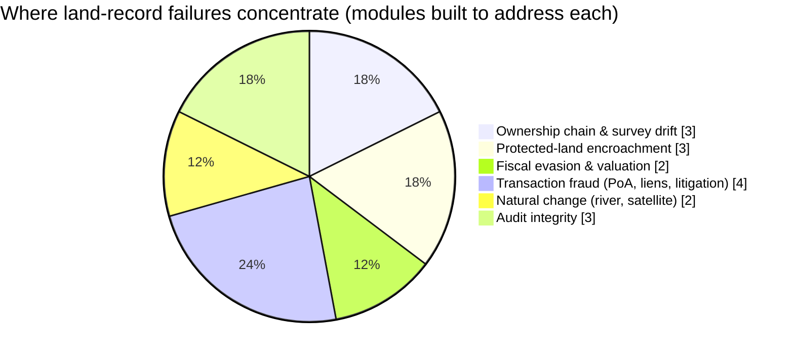

<sub>Counts show how many of the 17 modules primarily address each failure family.</sub>

---

## 💡 The BhumiRadar Solution

| Capability | What it does |
| :-- | :-- |
| 🛰️ **Satellite Cadastral Radar** | Temporal NDVI / NDWI / NDBI indices (2016 → 2026), river-erosion tracking and a live anomaly feed on a Leaflet GIS canvas |
| 🧬 **Four-Tier Khatian Lineage** | CS → SA → RS → BS comparison for the same Dag, with area-overshoot warnings (e.g. *BS records +8.0 decimals over RS*) |
| 🔒 **Litigation-aware Registry Lock** | Court orders (injunction, status quo) place a hard lock on deed registration, mutation and transfer until lifted |
| 🏛️ **Khas-Land Shield** | Government land inventory — allocated, vacant, encroached — with enforcement and recovery actions |
| 🏦 **Bank-Lien Intelligence** | Mortgage register, encumbrance-certificate (EC) tracking and a bank-lien alert surfaced *before* purchase |
| 📜 **PoA Sentinel** | Pre-registration security gate: validity, revocation, expiry, allowed action and area scope |
| 💰 **Smart Mouza-Rate Engine** | Minimum-value enforcement, undervaluation block alert and a full statutory fee breakdown |
| 🏗️ **Direct LA Compensation** | ARIPA 2017 award calculator with G2P EFT disbursement voucher |
| 🛡️ **Encroachment Detection** | Satellite + IoT-sensor alerts, severity triage, investigation and resolution tracking |
| 🔐 **Cryptographic Ledger** | SHA-256 chained blocks with an interactive tamper-simulation test |
| 📈 **Land Risk Score** | Composite 0–100 score from legal, physical, environmental and fraud sub-scores |
| 🧾 **Verifiable Certificates** | Print-ready A4 clearance & title-chain reports with QR and block hash |

---

## 📦 The 17 Modules

BhumiRadar's sidebar exposes 17 production modules, grouped into four governance pillars.

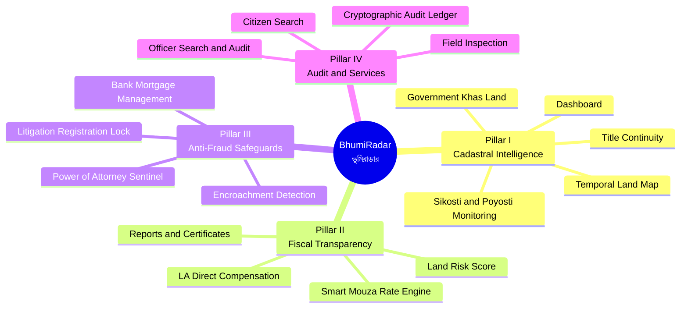

### Pillar I — Cadastral Intelligence & Survey Verification

| # | Module (বাংলা) | Purpose | Key capabilities |
| :-: | :-- | :-- | :-- |
| 1 | **Dashboard** (ড্যাশবোর্ড) | National operations cockpit | 5 switchable views (Panoramic Deck · Split GIS · Minimal Grid · Sikosti-Poyosti & Char · Citizen Trust Score); live KPIs; global plot search |
| 2 | **Temporal Land Map** (সময়ভিত্তিক ভূমি মানচিত্র) | Historical change by year | Year slider + autoplay 2016→2026; NDVI / NDWI / NDBI panels; compare & snapshot; layer filters |
| 3 | **Sikosti & Poyosti Monitoring** (শিকস্তি ও পয়স্তি পর্যবেক্ষণ) | River diluvion & accretion | Eroded vs newly-emerged plots; affected-area %; 60-day appeal workflow; registration freeze |
| 4 | **Title Continuity** (স্বত্বের ধারাবাহিকতা) | Ownership genealogy | Generation graph (G1→G4); deed/mutation table; duplicate-deed flags; flag-for-review |
| 5 | **Government Khas Land** (সরকারি খাসজমি) | Public-land inventory | Allocated / vacant / encroached ledger; allotment; one-click *Recover* for encroached parcels |

### Pillar II — Fiscal Transparency & Compensation

| # | Module | Purpose | Key capabilities |
| :-: | :-- | :-- | :-- |
| 6 | **Smart Mouza Rate Engine** (স্মার্ট মৌজা রেট ইঞ্জিন) | Valuation & revenue protection | Gazetted minimum value; *Registration Block Alert*; stamp / reg / local-tax / AIT; market estimate; receipt print |
| 7 | **LA Direct Compensation** (অধিগ্রহণ ক্ষতিপূরণ) | ARIPA 2017 awards | 200 %/300 % premium; structure, crop, tree & relocation heads; claim register; G2P EFT voucher |
| 8 | **Land Risk Score** (জমির ঝুঁকি স্কোর) | Plot-level risk intelligence | Composite score ring; legal / physical / environmental / fraud bars; recommendations; deed history |
| 9 | **Reports & Certificates** (প্রতিবেদন ও সনদ) | Official outputs | Full-parcel report; title-chain & khatian-chain certificate; print / PDF; QR verification |

### Pillar III — Anti-Fraud & Sovereign Safeguards

| # | Module | Purpose | Key capabilities |
| :-: | :-- | :-- | :-- |
| 10 | **Litigation Registration Lock** (মামলা-সংক্রান্ত নিবন্ধন লক) | Freeze disputed parcels | Case register (WP / CS / CR); lock history; full-parcel view; *Release lock* when order lifts |
| 11 | **Encroachment Detection** (ভূমি বেদখল শনাক্তকরণ) | Early-warning radar | Active alerts by severity; IoT sensor status; start investigation; mark resolved; citizen *Protect Khas Land* report |
| 12 | **PoA Sentinel** (আমমোক্তারনামা সেন্টিনেল) | Pre-registration gate | Select PoA → plot → proposed action → *Validity gate check*; statuses: active · revoked · expired · suspended |
| 13 | **Bank Mortgage Management** (ব্যাংক বন্ধক ব্যবস্থাপনা) | Lien register | Loan, outstanding, EC number, tenure; mortgage detail modal; *Release mortgage* |

### Pillar IV — Cryptographic Audit & Citizen / Officer Services

| # | Module | Purpose | Key capabilities |
| :-: | :-- | :-- | :-- |
| 14 | **Cryptographic Audit Ledger** (ক্রিপ্টোগ্রাফিক অডিট লেজার) | Tamper evidence | SHA-256 chain; per-actor events; integrity verify; tamper simulation & restore |
| 15 | **Citizen Search** (সাধারণ নাগরিক অনুসন্ধান) | Pre-purchase due diligence | District → Upazila → Mouza → Dag; risk & lien warnings; QR verification ID; field-inspection request |
| 16 | **Officer Search & Audit** (কর্মকর্তা অনুসন্ধান ও অডিট) | Investigative cadastral query | Query by Dag / Khatian / Deed / NID; 4-level khatian lineage; case & lock registry; officer action toolkit |
| 17 | **Field Inspection** (মাঠপর্যায়ের পরিদর্শন) | Ground-truth loop | Scheduled / ongoing / completed visits; findings, GPS pin, compliance outcome |

---

## 📊 Product Tour

> All screenshots are from the running application (Bengali UI; an English toggle is available in the header).

### 🛰️ Satellite Cadastral Radar — the Dashboard


Hero search (mouza · upazila & district · cadastral dag) feeds a one-click *Verification Report*. Five feature cards deep-link into: temporal satellite & river-erosion, smart litigation & sub-registry lock, khatian & chain-of-title graph, khas-land enforcement shield, and bank-lien & health score. A live operational strip shows plots tracked, active cases, encroachment alerts, bank mortgages and average risk.

<table>
<tr>
<td width="50%"><b>🗺️ Temporal Land Map</b><br/>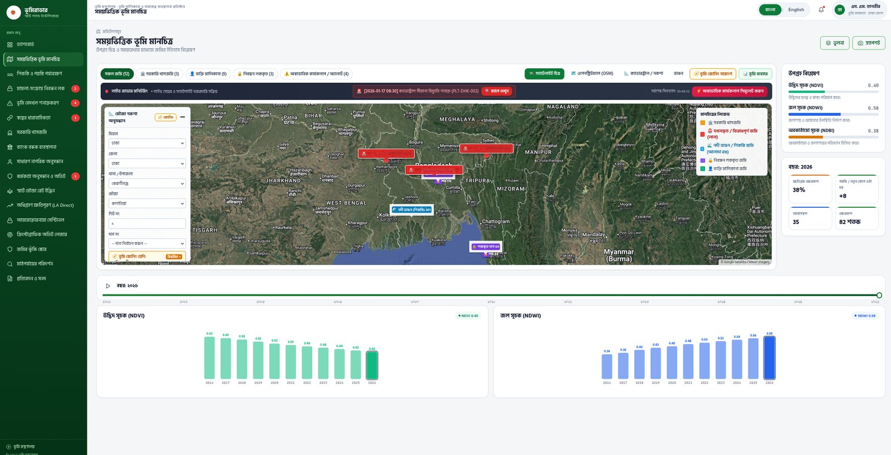<br/><sub>Year slider and autoplay; NDVI falls 0.62 → 0.40 while NDWI rises 0.34 → 0.58 (2016 → 2026).</sub></td>
<td width="50%"><b>🌊 Sikosti &amp; Poyosti</b><br/>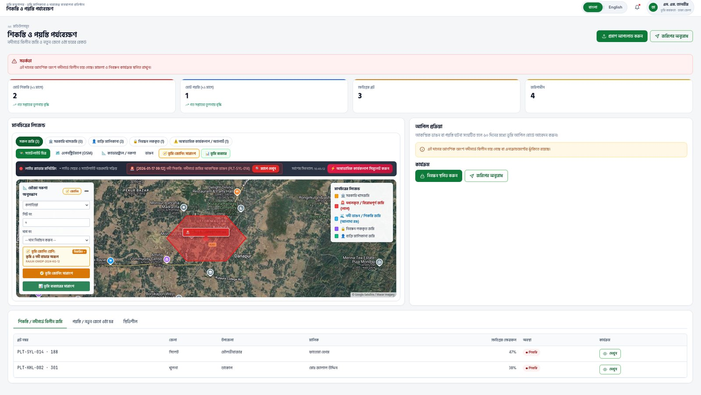<br/><sub>Partially river-eroded plots, 60-day appeal path, one-click registration freeze.</sub></td>
</tr>
<tr>
<td width="50%"><b>⚖️ Litigation Registration Lock</b><br/>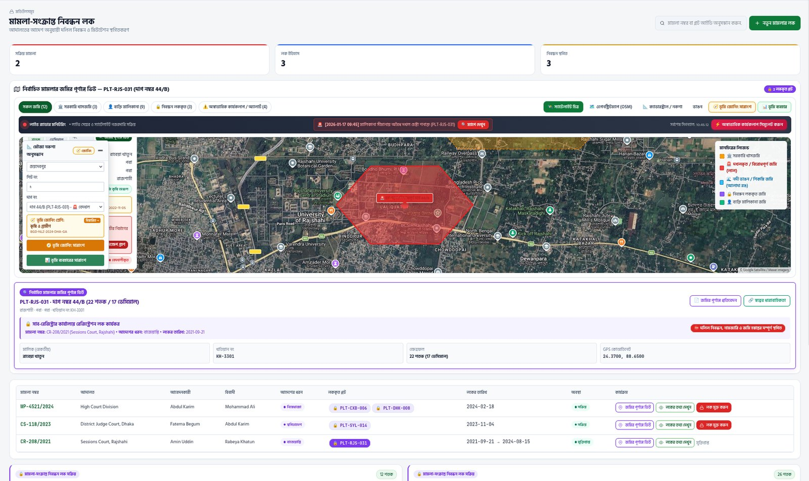<br/><sub>Full-parcel view for a court-locked plot, with case register and lock history.</sub></td>
<td width="50%"><b>🚨 Encroachment Detection</b><br/>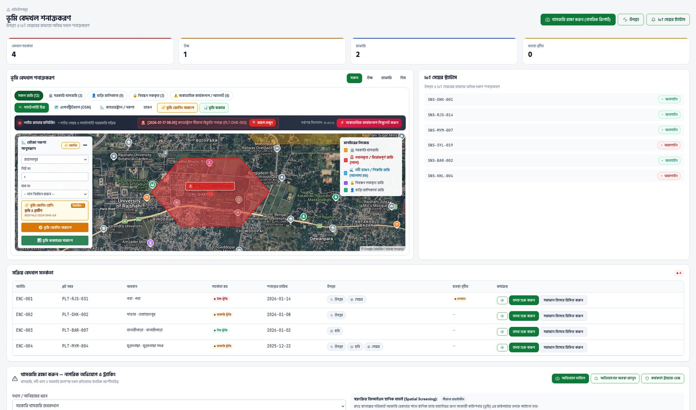<br/><sub>Severity-ranked alerts, IoT sensor grid and citizen reporting.</sub></td>
</tr>
<tr>
<td width="50%"><b>🧬 Title Continuity</b><br/>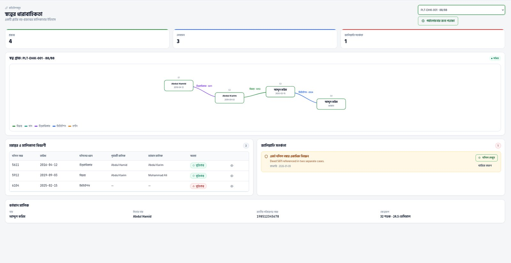<br/><sub>Generation graph, deed table and duplicate-deed alert.</sub></td>
<td width="50%"><b>🏛️ Government Khas Land</b><br/>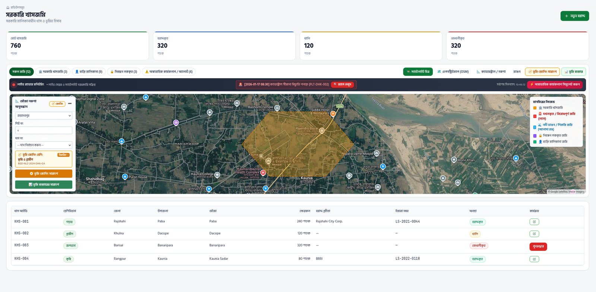<br/><sub>760 decimals tracked: 320 allocated · 120 vacant · 320 encroached.</sub></td>
</tr>
<tr>
<td width="50%"><b>🏦 Bank Mortgage Management</b><br/>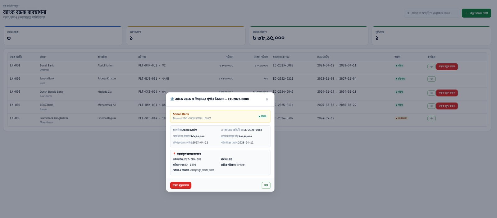<br/><sub>Lien register with an encumbrance-certificate detail modal.</sub></td>
<td width="50%"><b>🔎 Citizen Search</b><br/>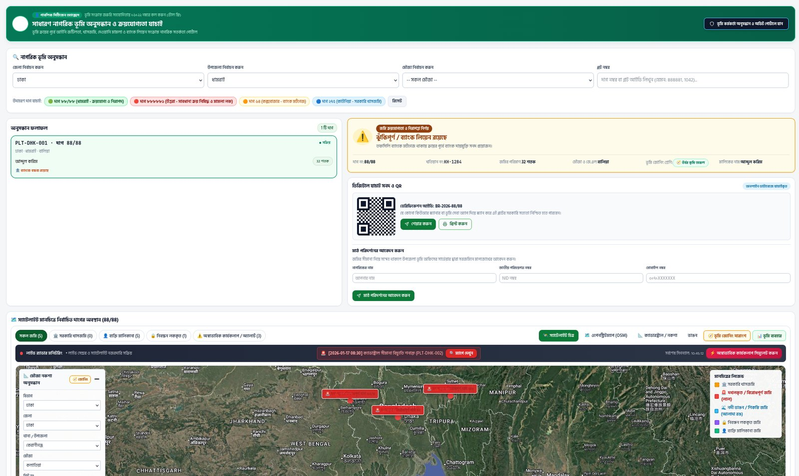<br/><sub>Risk &amp; lien verdict, QR verification and field-visit request.</sub></td>
</tr>
<tr>
<td width="50%"><b>🕵️ Officer Search &amp; Audit</b><br/>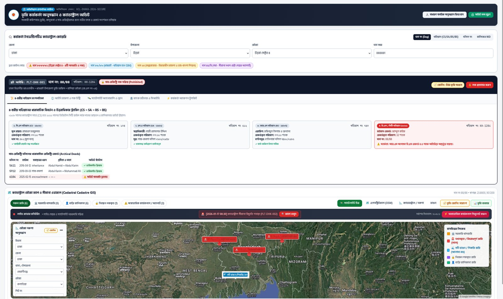<br/><sub>Cadastral query with four-tier khatian lineage and action toolkit.</sub></td>
<td width="50%"><b>💰 Smart Mouza-Rate Engine</b><br/>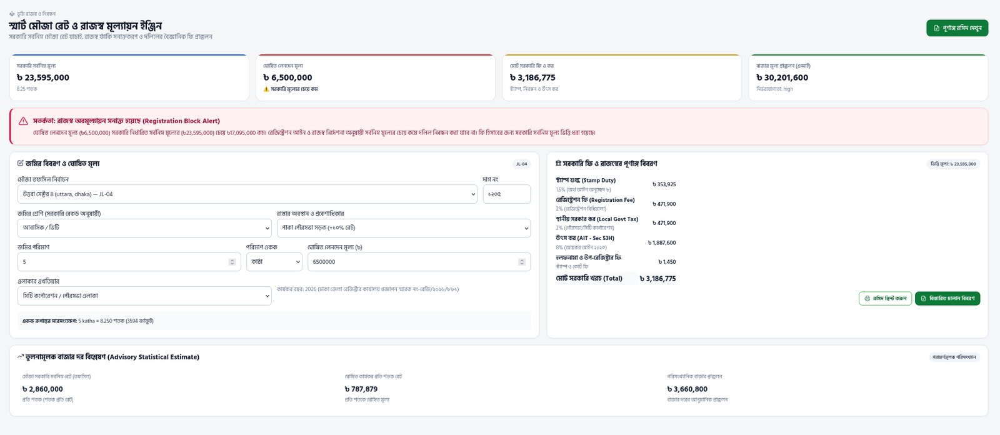<br/><sub>Undervaluation block alert and statutory fee breakdown.</sub></td>
</tr>
<tr>
<td width="50%"><b>🏗️ LA Direct Compensation</b><br/>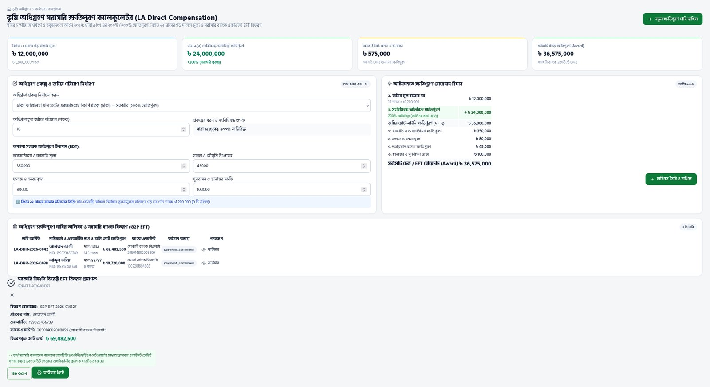<br/><sub>200 % ARIPA premium, claim register and G2P EFT voucher.</sub></td>
<td width="50%"><b>📜 PoA Sentinel</b><br/>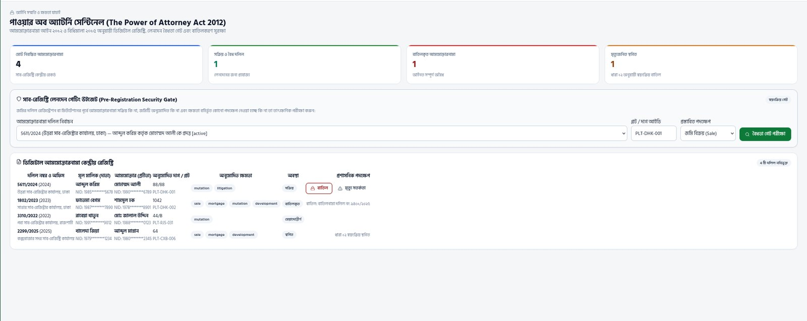<br/><sub>Pre-registration validity gate across the central PoA registry.</sub></td>
</tr>
<tr>
<td width="50%"><b>🔐 Cryptographic Ledger</b><br/>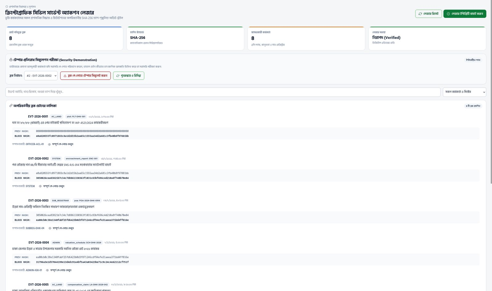<br/><sub>Hash-chained blocks with tamper simulation.</sub></td>
<td width="50%"><b>📈 Land Risk Score</b><br/>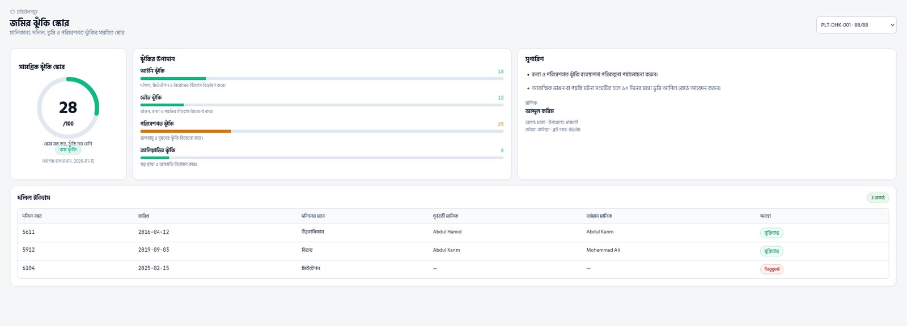<br/><sub>Composite score 28/100 (low) with factor breakdown.</sub></td>
</tr>
<tr>
<td width="50%"><b>🧭 Field Inspection</b><br/>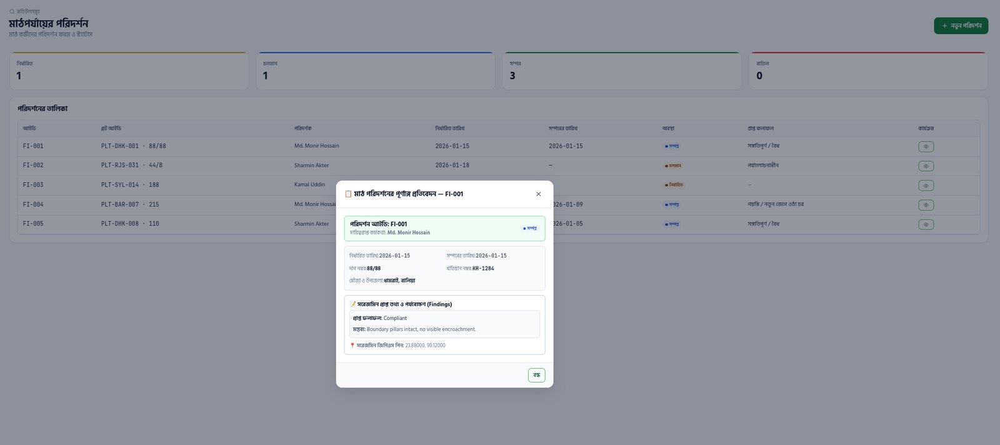<br/><sub>Scheduled → ongoing → completed visits with findings.</sub></td>
<td width="50%"><b>🧾 Title-Chain Certificate</b><br/>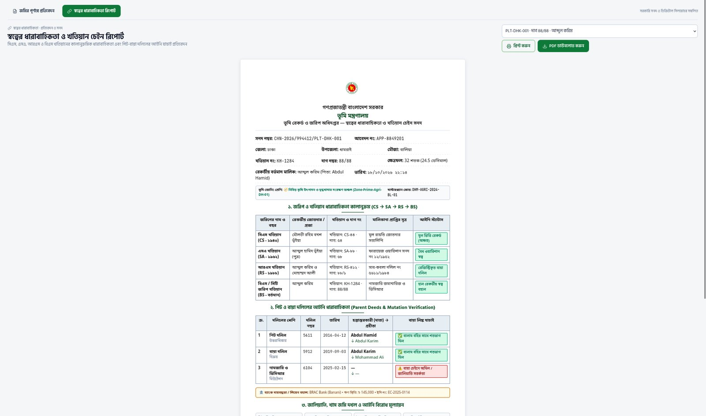<br/><sub>Printable A4 chain-of-title report with parent-deed verification.</sub></td>
</tr>
</table>

### 📱 Responsive field experience

<div align="center">
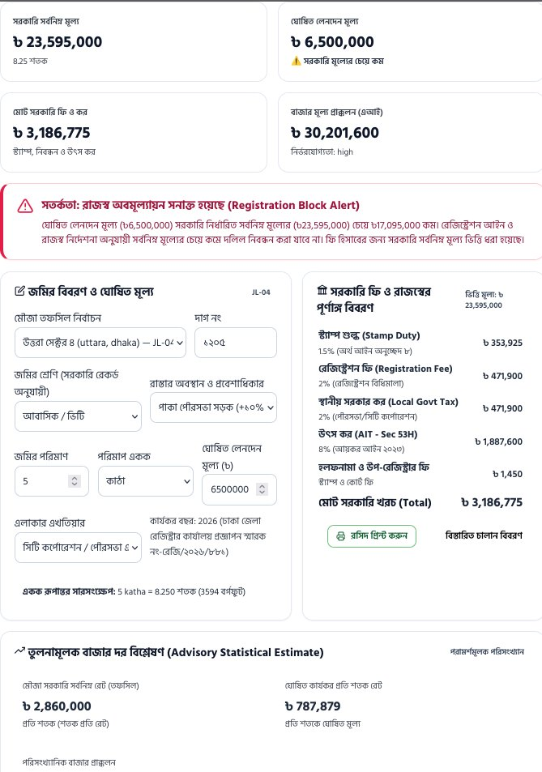
<br/><sub><i>The valuation engine reflows to a single column on narrow screens — usable by a Tahsildar in the field.</i></sub>
</div>

---

## 👥 Roles & Personas

| Persona | Bengali | Primary goals | Main modules |
| :-- | :-- | :-- | :-- |
| 🧑‍🌾 **Citizen / Buyer** | সাধারণ নাগরিক | Check a plot before buying; know total government cost; report grabbing | Citizen Search · Mouza Rate · Risk Score · Encroachment (report) · Certificates |
| 🏛️ **AC (Land)** | সহকারী কমিশনার (ভূমি) | Protect khas land; approve mutation; handle appeals | Dashboard · Khas · Encroachment · Sikosti · Title Continuity · Ledger |
| 📜 **Sub-Registrar** | সাব-রেজিস্ট্রার | Block illegal registrations; verify PoA & value | PoA Sentinel · Litigation Lock · Mouza Rate · Bank Mortgage |
| 📐 **Kanungo / Surveyor** | কানুনগো | Ground-truth, demarcation, GPS evidence | Field Inspection · Encroachment · Temporal Map |
| 💰 **LA Collector (ADC)** | অতিরিক্ত জেলা প্রশাসক | Compute and disburse compensation | LA Compensation · Ledger |
| 🏦 **Bank Officer** | ব্যাংক কর্মকর্তা | Register and discharge liens | Bank Mortgage |
| 🔍 **Auditor** | নিরীক্ষক | Verify no record was altered | Cryptographic Ledger · Officer Search & Audit |

---

## 🧭 System Architecture

BhumiRadar is a **client-side single-page application** with a strict separation between presentation, domain services and a pure-JavaScript security core. Government integrations sit behind replaceable adapter contracts so that simulated demo interfaces can be swapped for authorised live APIs without touching UI code.

### 7.1 High-Level Architecture

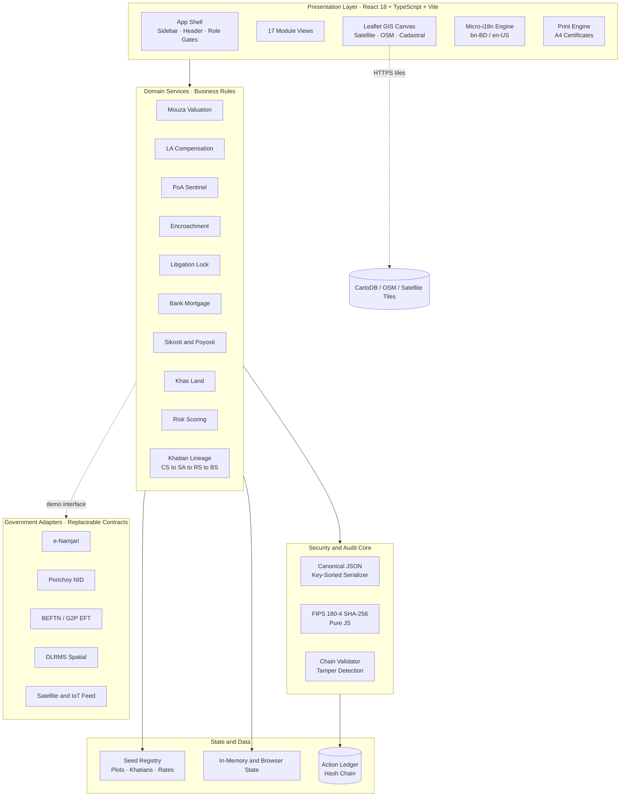

### 7.2 Deployment Architecture

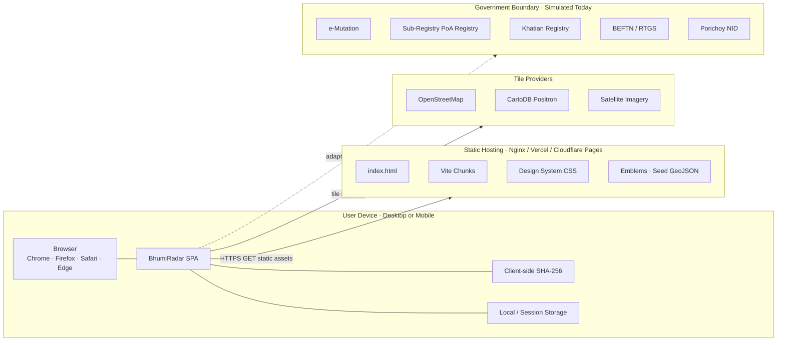

### 7.3 Layered Responsibility Matrix

| Layer | Owns | Must never |
| :-- | :-- | :-- |
| **Presentation** | Rendering, navigation, i18n, print layout | Contain statutory arithmetic |
| **Domain services** | Legal rules, calculations, state transitions | Touch the DOM |
| **Security core** | Canonical serialisation, hashing, chain verification | Depend on any external library |
| **Adapters** | Translating to/from government systems | Leak vendor shapes into domain types |
| **State** | Seed data, session data, ledger persistence | Be trusted without chain verification |

---

## 🧩 UML Diagrams

> All diagrams are Mermaid and render natively on GitHub. Source copies live in [`docs/`](#-documentation-index).

### 8.1 Use Case Diagram

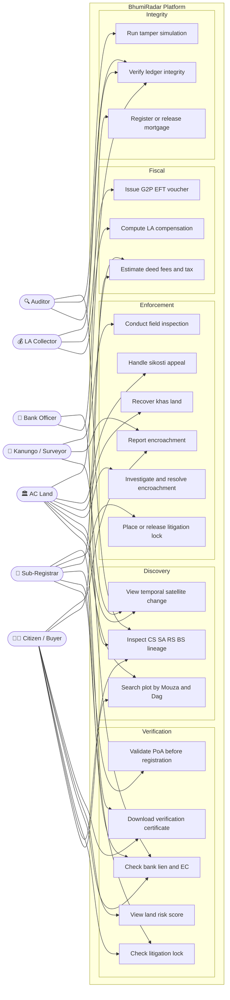

### 8.2 Class Diagram — Domain Model

```mermaid
classDiagram
    direction LR

    class Mouza {
        +String mouzaId
        +String district
        +String upazila
        +String nameBn
        +String nameEn
        +String jlNumber
    }

    class Plot {
        +String plotId
        +String dagNumber
        +String landClass
        +Float areaDecimals
        +LandCategory category
        +Polygon geometry
        +Int riskScore
        +isProtected() Boolean
        +isLocked() Boolean
    }

    class KhatianRecord {
        +String khatianId
        +SurveyEpoch epoch
        +String khatianNumber
        +String recordedOwner
        +Float recordedArea
        +areaDelta(other) Float
    }

    class Owner {
        +String ownerId
        +String name
        +String fatherName
        +String nidMasked
    }

    class Deed {
        +String deedNumber
        +DeedType type
        +Date date
        +String fromOwner
        +String toOwner
        +DeedStatus status
    }

    class CourtCase {
        +String caseNumber
        +String court
        +OrderType orderType
        +Date lockDate
        +CaseStatus status
    }

    class RegistrationLock {
        +String lockId
        +LockReason reason
        +Boolean active
        +release(reason) void
    }

    class BankMortgage {
        +String lienId
        +String bank
        +String borrower
        +Money principal
        +Money outstanding
        +String ecNumber
        +Date start
        +Date end
        +MortgageStatus status
    }

    class PowerOfAttorney {
        +String deedNumber
        +String principal
        +String attorney
        +String[] allowedActions
        +PoAStatus status
        +validateGate(action, plot) GateResult
    }

    class EncroachmentAlert {
        +String alertId
        +Severity severity
        +Date detectedOn
        +String[] evidence
        +AlertStatus status
        +startInvestigation() void
        +markResolved() void
    }

    class SensorNode {
        +String sensorId
        +SensorState state
    }

    class KhasParcel {
        +String khasId
        +String category
        +Float areaDecimals
        +KhasStatus status
        +allocate(to) void
        +recover() void
    }

    class RiverChangeEvent {
        +RiverChangeType type
        +Float affectedPercent
        +Date appealDeadline
    }

    class LACompensationClaim {
        +String claimId
        +String project
        +Money baseValue
        +Float premiumRate
        +Money structures
        +Money crops
        +Money trees
        +Money relocation
        +Money totalAward
        +award() Money
    }

    class FieldInspection {
        +String inspectionId
        +String officer
        +Date scheduled
        +Date completed
        +Outcome outcome
        +GeoPoint pin
    }

    class RiskScore {
        +Int legal
        +Int physical
        +Int environmental
        +Int fraud
        +Int total
        +band() RiskBand
    }

    class LedgerBlock {
        +Int index
        +String eventId
        +String actor
        +String payloadHash
        +String previousHash
        +String hash
        +Boolean verify()
    }

    class Certificate {
        +String verificationId
        +String qrPayload
        +String blockHash
    }

    Mouza "1" o-- "*" Plot
    Plot "1" o-- "4" KhatianRecord : CS SA RS BS
    Plot "*" --> "1..*" Owner : owned by
    Plot "1" o-- "*" Deed
    Plot "1" o-- "*" CourtCase
    CourtCase "1" --> "0..1" RegistrationLock : triggers
    Plot "1" o-- "*" BankMortgage
    Plot "1" o-- "*" PowerOfAttorney
    Plot "1" o-- "*" EncroachmentAlert
    EncroachmentAlert "*" --> "*" SensorNode : detected by
    Plot "0..1" --> "1" KhasParcel : is
    Plot "1" o-- "*" RiverChangeEvent
    Plot "1" o-- "*" LACompensationClaim
    Plot "1" o-- "*" FieldInspection
    Plot "1" --> "1" RiskScore
    Plot "1" --> "*" LedgerBlock : audited by
    Plot "1" --> "*" Certificate : certified by
    LedgerBlock "1" --> "0..1" LedgerBlock : previous
```

#### Service-layer class diagram

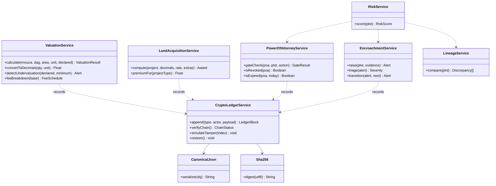

### 8.3 Component Diagram

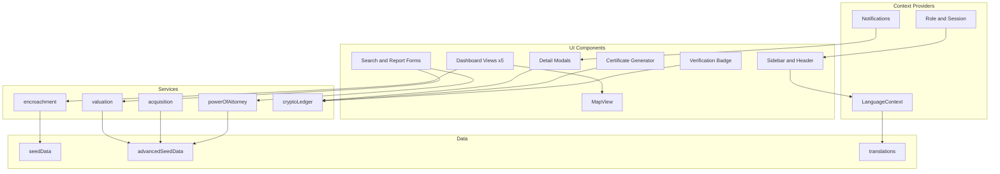

### 8.4 Package Diagram

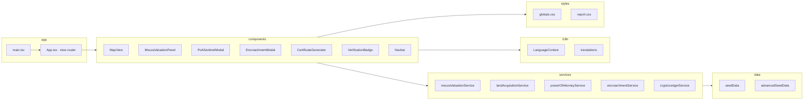

### 8.5 Sequence Diagrams

#### (a) Citizen pre-purchase due diligence

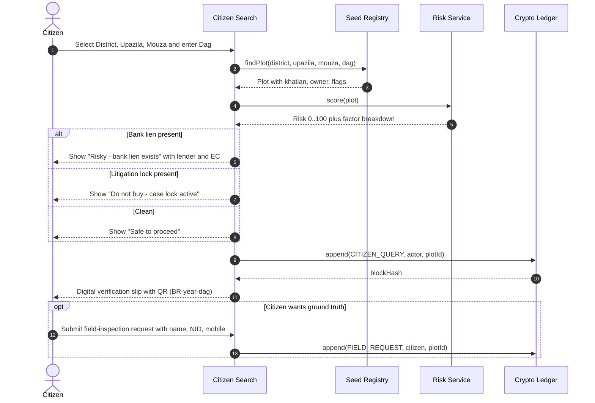

#### (b) Registration gate — Sub-Registrar checks a sale deed

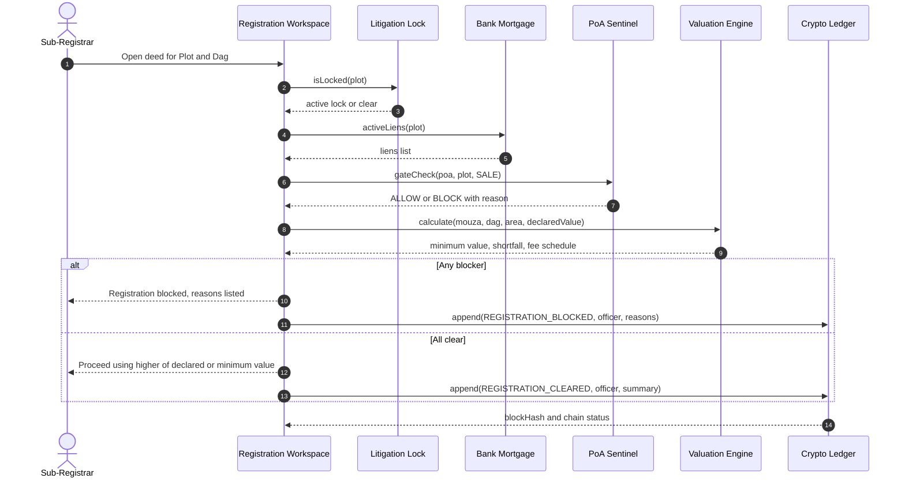

#### (c) Litigation lock — place and release

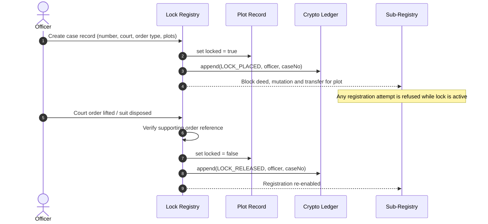

#### (d) Encroachment detection to resolution

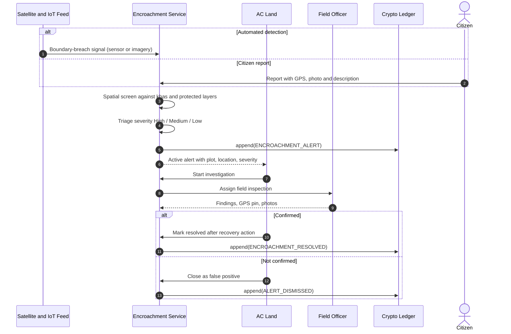

#### (e) Sikosti appeal within 60 days

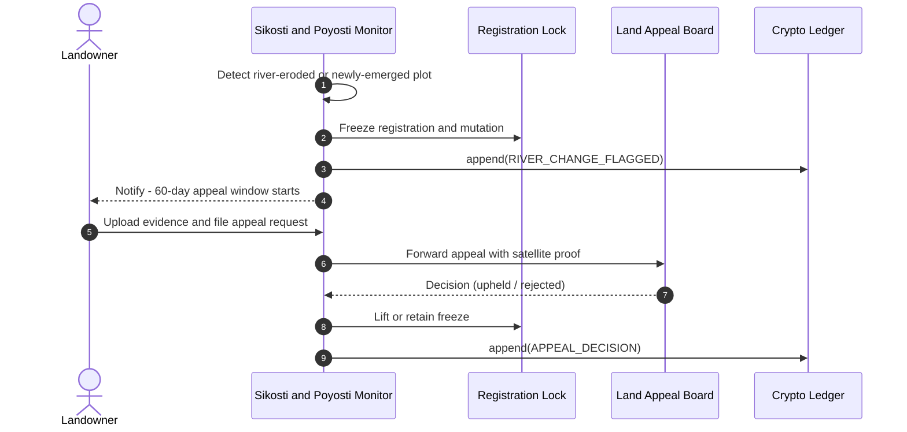

#### (f) LA direct compensation and G2P disbursement

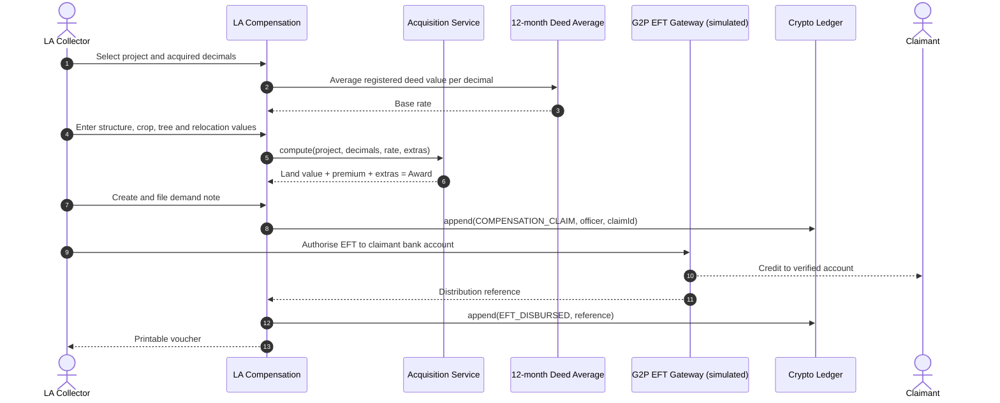

#### (g) Tamper detection

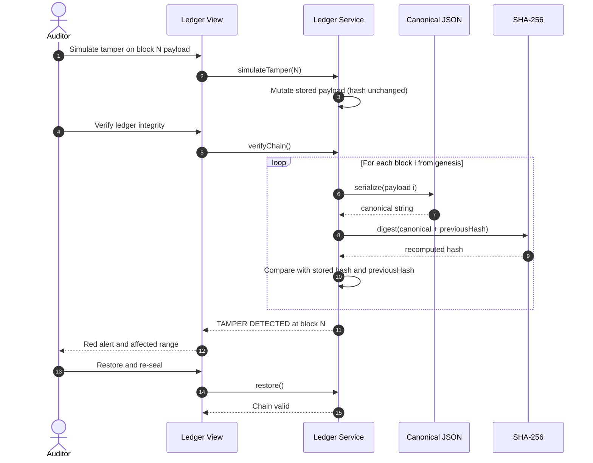

### 8.6 Activity / Workflow Diagrams

#### (a) Master plot-verification workflow

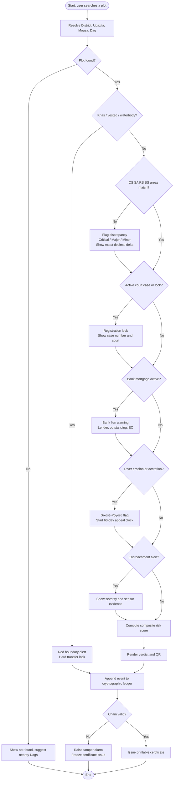

#### (b) Deed valuation and fee workflow

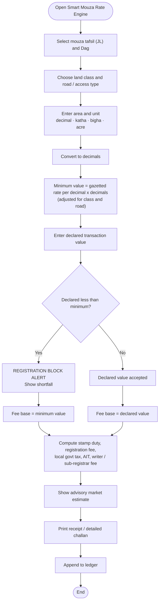

#### (c) Encroachment lifecycle workflow

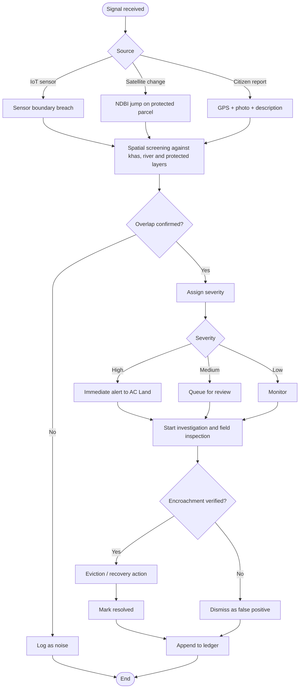

#### (d) PoA validity gate

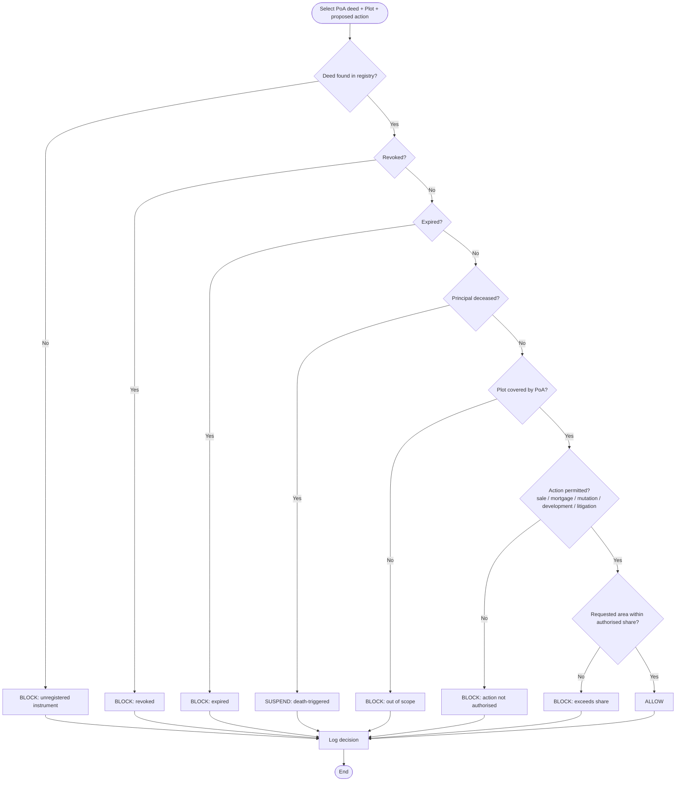

#### (e) Risk-score computation

```mermaid
flowchart LR
    subgraph IN["Inputs"]
        I1["Deeds · mutations · disputes"]
        I2["Erosion and accretion history"]
        I3["Flood-zone and hydrology"]
        I4["Fraud signals<br/>duplicate deeds, flagged mutation"]
    end
    I1 --> L["Legal risk"]
    I2 --> P["Physical risk"]
    I3 --> V["Environmental risk"]
    I4 --> F["Fraud risk"]
    L & P & V & F --> AGG["Aggregate to 0-100"]
    AGG --> BAND{"Band"}
    BAND -- "low" --> B1["Low risk"]
    BAND -- "mid" --> B2["Moderate risk"]
    BAND -- "high" --> B3["High risk"]
    B1 & B2 & B3 --> REC["Recommendations + owner summary"]
```

### 8.7 State Machine Diagrams

#### Encroachment alert

```mermaid
stateDiagram-v2
    [*] --> Detected
    Detected --> Triaged : severity assigned
    Triaged --> Investigating : start investigation
    Investigating --> ActionTaken : encroachment verified
    Investigating --> Dismissed : false positive
    ActionTaken --> Resolved : mark resolved
    Resolved --> [*]
    Dismissed --> [*]
```

#### Litigation registration lock

```mermaid
stateDiagram-v2
    [*] --> Unlocked
    Unlocked --> Locked : case filed + court order
    Locked --> Locked : new case added
    Locked --> Released : order lifted / suit disposed
    Released --> Unlocked : lock record archived
    Locked --> Violation : registration attempt
    Violation --> Locked : attempt refused and logged
```

#### Power of Attorney

```mermaid
stateDiagram-v2
    [*] --> Active : registered at sub-registry
    Active --> Revoked : principal revokes
    Active --> Expired : term ends
    Active --> Suspended : principal deceased
    Suspended --> Revoked : heirs confirm
    Revoked --> [*]
    Expired --> [*]
```

#### Bank mortgage

```mermaid
stateDiagram-v2
    [*] --> UnderReview : lien application
    UnderReview --> Active : EC issued
    UnderReview --> Rejected : documents invalid
    Active --> Released : loan cleared
    Active --> Defaulted : repayment failure
    Defaulted --> Released : settlement
    Released --> [*]
    Rejected --> [*]
```

#### Sikosti / Poyosti plot

```mermaid
stateDiagram-v2
    [*] --> Stable
    Stable --> Eroding : river diluvion detected
    Eroding --> Submerged : fully river-bed
    Eroding --> Appealed : owner files within 60 days
    Appealed --> Stable : appeal upheld
    Appealed --> Submerged : appeal rejected
    Stable --> NewChar : accretion emerges
    NewChar --> StateOwned : claimed under SATA
    Submerged --> [*]
```

#### LA compensation claim

```mermaid
stateDiagram-v2
    [*] --> Filed
    Filed --> Calculated : award computed
    Calculated --> Verified : bank account and NID verified
    Verified --> PaymentConfirmed : G2P EFT sent
    PaymentConfirmed --> Closed : voucher printed
    Verified --> Disputed : claimant objects
    Disputed --> Calculated : recomputed
    Closed --> [*]
```

#### Field inspection

```mermaid
stateDiagram-v2
    [*] --> Scheduled
    Scheduled --> InProgress : officer arrives
    InProgress --> Completed : findings submitted
    InProgress --> Rejected : insufficient evidence
    Rejected --> Scheduled : rescheduled
    Completed --> [*]
```

#### Ledger block

```mermaid
stateDiagram-v2
    [*] --> Pending
    Pending --> Committed : hash computed and linked
    Committed --> Verified : chain walk OK
    Committed --> Tampered : hash mismatch found
    Tampered --> Committed : restore and re-seal
```

### 8.8 Entity-Relationship Diagram

```mermaid
erDiagram
    MOUZA ||--o{ PLOT : contains
    MOUZA ||--o{ MOUZA_RATE : priced_by
    PLOT ||--o{ KHATIAN_RECORD : recorded_in
    PLOT }o--o{ OWNER : owned_by
    PLOT ||--o{ DEED : transferred_by
    PLOT ||--o{ COURT_CASE : subject_of
    COURT_CASE ||--o| REGISTRATION_LOCK : triggers
    PLOT ||--o{ BANK_MORTGAGE : encumbered_by
    PLOT ||--o{ POWER_OF_ATTORNEY : covered_by
    PLOT ||--o{ ENCROACHMENT_ALERT : threatened_by
    SENSOR ||--o{ ENCROACHMENT_ALERT : raises
    PLOT ||--o| KHAS_PARCEL : classified_as
    PLOT ||--o{ RIVER_CHANGE_EVENT : affected_by
    PLOT ||--o{ LA_CLAIM : acquired_by
    PLOT ||--o{ FIELD_INSPECTION : visited
    PLOT ||--o| RISK_SCORE : rated
    PLOT ||--o{ LEDGER_BLOCK : audited
    LEDGER_BLOCK o|--o{ LEDGER_BLOCK : previous

    MOUZA {
        string mouzaId PK
        string district
        string upazila
        string nameBn
        string nameEn
        string jlNumber
    }

    PLOT {
        string plotId PK
        string mouzaId FK
        string dagNumber
        string landClass
        float areaDecimals
        string category
        string geometry
        int riskScore
    }

    KHATIAN_RECORD {
        string khatianId PK
        string plotId FK
        string epoch
        string khatianNumber
        string recordedOwner
        float recordedArea
    }

    OWNER {
        string ownerId PK
        string name
        string fatherName
        string nidMasked
    }

    DEED {
        string deedNumber PK
        string plotId FK
        string type
        date deedDate
        string fromOwner
        string toOwner
        string status
    }

    COURT_CASE {
        string caseNumber PK
        string court
        string orderType
        date lockDate
        string status
    }

    REGISTRATION_LOCK {
        string lockId PK
        string caseNumber FK
        boolean active
        string releaseReason
    }

    BANK_MORTGAGE {
        string lienId PK
        string plotId FK
        string bank
        string borrower
        decimal principal
        decimal outstanding
        string ecNumber
        date startDate
        date endDate
        string status
    }

    POWER_OF_ATTORNEY {
        string deedNumber PK
        string plotId FK
        string principal
        string attorney
        string allowedActions
        float maxArea
        string status
    }

    ENCROACHMENT_ALERT {
        string alertId PK
        string plotId FK
        string sensorId FK
        string severity
        date detectedOn
        string status
    }

    SENSOR {
        string sensorId PK
        string state
    }

    KHAS_PARCEL {
        string khasId PK
        string plotId FK
        string category
        float areaDecimals
        string status
    }

    RIVER_CHANGE_EVENT {
        string eventId PK
        string plotId FK
        string kind
        float affectedPercent
        date appealDeadline
    }

    LA_CLAIM {
        string claimId PK
        string plotId FK
        string project
        decimal baseValue
        float premium
        decimal totalAward
        string status
    }

    FIELD_INSPECTION {
        string inspectionId PK
        string plotId FK
        string officer
        date scheduled
        date completed
        string outcome
    }

    RISK_SCORE {
        string plotId PK
        int legal
        int physical
        int environmental
        int fraud
        int total
    }

    MOUZA_RATE {
        string rateId PK
        string mouzaId FK
        string landClass
        decimal ratePerDecimal
        int effectiveYear
    }

    LEDGER_BLOCK {
        int idx PK
        string eventId
        string eventType
        string actor
        string plotId FK
        string payloadHash
        string previousHash
        string hash
    }

---

## 📈 Data & Analytics Graphs

The charts below are drawn from the **seeded demonstration dataset** shipped with the app (12 plots across 10 districts) — the same figures visible in the screenshots.

### Satellite indices over time (Temporal Land Map)

Vegetation (NDVI) declines while open-water signal (NDWI) rises across 2016 → 2026 for the sample parcel — the pattern the *Sikosti & Poyosti* module treats as a river-encroachment signature.

```mermaid
xychart-beta
    title "NDVI (falling) vs NDWI (rising), 2016-2026"
    x-axis [2016, 2017, 2018, 2019, 2020, 2021, 2022, 2023, 2024, 2025, 2026]
    y-axis "Index value" 0.2 --> 0.7
    line [0.62, 0.60, 0.58, 0.55, 0.52, 0.50, 0.48, 0.46, 0.44, 0.42, 0.40]
    line [0.34, 0.36, 0.40, 0.43, 0.45, 0.48, 0.50, 0.52, 0.54, 0.56, 0.58]
```

<sub>Upper-left line = NDVI · lower-left line = NDWI. 2026 snapshot: NDVI 0.40 · NDWI 0.58 · NDBI 0.38.</sub>

### Government khas-land inventory (decimals)

```mermaid
pie showData
    title Khas land status - 760 decimals tracked
    "Allocated" : 320
    "Vacant" : 120
    "Encroached" : 320
```

### Encroachment alerts by severity

```mermaid
pie showData
    title 4 active encroachment alerts
    "High" : 1
    "Medium" : 2
    "Low" : 1
```

### Land-risk factor breakdown (sample plot · composite 28/100 · *low risk*)

```mermaid
xychart-beta
    title "Risk factors - PLT-DHK-001 (Dag 88/88)"
    x-axis ["Legal", "Physical", "Environmental", "Fraud"]
    y-axis "Score" 0 --> 40
    bar [18, 12, 25, 8]
```

### Seed-dataset at a glance

| Metric | Value | Metric | Value |
| :-- | --: | :-- | --: |
| Plot records | **12** | Active court cases | **2** |
| Private plots | 9 | Registration-locked plots | 3 |
| Khas plots | 3 | Encroachment alerts | 4 |
| Bank mortgages (active) | 3 | IoT sensors online / offline | 4 / 2 |
| Field inspections | 5 (1 scheduled · 1 ongoing · 3 completed) | Ledger blocks | 8 |
| PoA instruments | 4 (1 active · 1 revoked · 1 expired · 1 suspended) | Average portfolio risk | 45 |

| Sample plot | Location | Story it demonstrates |
| :-- | :-- | :-- |
| `PLT-DHK-001` · Dag 88/88 | Dhamrai, Dhaka | Clean title, but a **bank lien** — and a flagged mutation (deed 6104) |
| `PLT-DHK-002` · Dag 92 | Savar, Dhaka | Sonali Bank mortgage; encroachment alert |
| `PLT-RJS-031` · Dag 44/B | Paba, Rajshahi | **Court-locked** (CR-208/2021); boundary-grab attempt |
| `PLT-SYL-014` · Dag 188 | Moulvibazar, Sylhet | **Sikosti** — 47 % river-eroded |
| `PLT-KHL-002` · Dag 301 | Dacope, Khulna | **Sikosti** — 38 % river-eroded |
| `PLT-CXB-006` · Dag 64 | Cox's Bazar | Litigation + bank lien together |
| `Dag 888881` | Uttara Sector 8, Dhaka | "Do-not-buy" demo: purchase-prohibited verdict with case lock |

---

## 🔐 Cryptographic Action Ledger Deep Dive

Every consequential action becomes a **block**. A block's hash commits to its own canonicalised payload *and* to the previous block's hash, so changing any historical byte invalidates every block after it.

```mermaid
flowchart LR
    G["Block 0 · Genesis<br/>prev = 64 zeros<br/>EVT-2026-0001<br/>hash e0a820555f…"]
    B1["Block 1<br/>EVT-2026-0002<br/>prev e0a820555f…<br/>hash 3050026cea…"]
    B2["Block 2<br/>EVT-2026-0003<br/>prev 3050026cea…<br/>hash ea00cb0c38…"]
    B3["Block 3<br/>EVT-2026-0004<br/>prev ea00cb0c38…<br/>hash 31796a3e1d…"]
    BN["Block N …"]
    G --> B1 --> B2 --> B3 --> BN
```

<sub>Hashes shown are the first ten hex characters of the sample chain visible in the ledger screenshot.</sub>

### Block anatomy

| Field | Meaning |
| :-- | :-- |
| `eventId` | `EVT-YYYY-NNNN`, monotonic |
| `actorRole` | `AC_LAND` · `SUB_REGISTRAR` · `ADMIN` · `SYSTEM` … |
| `subject` | Typed reference, e.g. `plot: PLT-DHK-001`, `encroachment_report: ENC-001`, `compensation_claim: LA-DHK-2026-0042` |
| `payload` | Canonical JSON (keys sorted; deterministic across runtimes) |
| `previousHash` | Hash of preceding block (64 zeros at genesis) |
| `hash` | `SHA-256( canonical(payload) ‖ previousHash )` |
| `executor` | Officer / system identity (e.g. `OFFICER-ACL-01`, `SUBREG-DHK-04`) |

### Algorithm

```ts
// Conceptual — see src/services/cryptoLedgerService.ts
function appendBlock(type: EventType, actor: Actor, payload: object): Block {
  const prev = chain.length ? chain[chain.length - 1].hash : "0".repeat(64);
  const canonical = canonicalJson(payload);          // sorted keys, no whitespace
  const hash = sha256(canonical + prev);             // pure FIPS 180-4
  const block = { index: chain.length, type, actor, payload, previousHash: prev, hash };
  chain.push(block);
  return block;
}

function verifyChain(): { valid: boolean; brokenAt?: number } {
  let prev = "0".repeat(64);
  for (const b of chain) {
    if (b.previousHash !== prev) return { valid: false, brokenAt: b.index };
    if (sha256(canonicalJson(b.payload) + prev) !== b.hash) return { valid: false, brokenAt: b.index };
    prev = b.hash;
  }
  return { valid: true };
}
```

### Why it matters

- **Tamper-evident, not tamper-proof** — an adversary with write access can edit data, but cannot do so *silently*.
- **Deterministic everywhere** — no `crypto.subtle` dependency, identical digests in browsers and Node.
- **Demonstrable** — the *Tamper Simulation* panel mutates a block payload on demand and lets you watch verification fail, then **restore & re-seal**.

---

## 🧮 Statutory Calculation Engines

> Rates are encoded as named constants so they can be updated when a gazette or finance act changes them.

### A. Smart Mouza-Rate & Revenue Valuation

**Minimum value** = gazetted mouza rate per decimal × area in decimals (adjusted for land class and road access).  
**Fee base** = `max(declared value, minimum value)` — an undervalued deed triggers the **Registration Block Alert**.

| Component | Rate | Basis |
| :-- | :-: | :-- |
| Stamp duty | **1.5 %** | Stamp Act (as encoded) |
| Registration fee | **2 %** | Registration Act (as encoded) |
| Local-government tax | **2 %** | City corporation / pourashava areas (varies by jurisdiction) |
| Advance Income Tax (AIT) | **8 %** | Income Tax Act 2023, § 53H |
| Deed-writer & sub-registrar / court fees | Fixed | Stamp & court fee schedule |

**Unit conversion used by the engine:** `1 katha = 1.65 decimal` · `1 decimal = 435.6 sq ft` (→ 5 katha = 8.250 decimal ≈ 3,594 sq ft).

#### Worked example (Uttara Sector 8, Dag 6205, 5 katha, residential, paved road)

| Item | Amount (৳) |
| :-- | --: |
| Gazetted minimum value (8.25 decimals × ৳2,860,000) | **23,595,000** |
| Declared transaction value | 6,500,000 |
| Shortfall → **Registration Block Alert** | 17,095,000 |
| Stamp duty 1.5 % of 23,595,000 | 353,925 |
| Registration fee 2 % | 471,900 |
| Local-government tax 2 % | 471,900 |
| AIT 8 % | 1,887,600 |
| Deed-writer / sub-registrar / court fee | 1,450 |
| **Total government cost** | **3,186,775** |
| Advisory statistical market estimate (8.25 × ৳3,660,800) | 30,201,600 |

### B. ARIPA 2017 Direct Compensation

```text
Base land value        = decimals × average registered deed value per decimal (last 12 months)
Statutory premium      = base × 200 %   (public project, s.9(3)(ka))   |  300 % for non-government acquisition
Land compensation      = base + premium
Supplementary heads    = structures + standing crops + trees + relocation / shifting
AWARD (EFT payable)    = land compensation + supplementary heads
```

#### Worked example (Dhaka–Ashulia Elevated Expressway, 10 decimals)

| Head | Amount (৳) |
| :-- | --: |
| 1. Base land value (10 dec × ৳1,200,000) | 12,000,000 |
| 2. Statutory premium +200 % | 24,000,000 |
| **Land compensation** | **36,000,000** |
| 3. Structures & buildings | 350,000 |
| 4. Fruit & timber trees | 80,000 |
| 5. Standing crops | 45,000 |
| 6. Relocation & shifting allowance | 100,000 |
| **Total award (G2P EFT)** | **36,575,000** |

### C. Khatian Lineage Matcher (CS → SA → RS → BS)

For a Dag, the matcher lines up four survey epochs and classifies the **area delta** between consecutive records:

| Severity | Typical trigger |
| :-- | :-- |
| 🔴 **Critical** | A later epoch records *more* land than the preceding one without a documented transfer (e.g. *BS = RS + 8.0 decimals*) |
| 🟠 **Major** | Owner chain break or inheritance-share mismatch |
| 🟡 **Minor** | Spelling variants, unit rounding |

---

## 🔧 Technology Stack

| Technology | Version | Role | Why |
| :-- | :-: | :-- | :-- |
| **React** | 18.3 | View layer | Concurrent rendering, composable module views |
| **TypeScript** | 5.6 | Type safety | Strict contracts for legal schemas and money arithmetic |
| **Vite** | 5.4 | Build & dev server | Instant HMR, optimised Rollup output |
| **Leaflet** | 1.9 | GIS canvas | Light, mobile-friendly; native GeoJSON; satellite / OSM / cadastral layers |
| **Pure-JS SHA-256** | FIPS 180-4 | Ledger hashing | Zero dependencies; bit-exact across runtimes |
| **Lucide React** | 0.454 | Iconography | Consistent, accessible icons |
| **Vanilla CSS** | — | Design system & print | CSS variables, A4 print stylesheet, no framework weight |
| **Micro-i18n** | in-house | bn-BD ⇄ en-US | Zero-reload toggle, Bengali numeral transliteration (`১২৩৪`) |
| **Mermaid** | docs | Diagrams-as-code | Version-controlled UML that renders on GitHub |

### 🌐 Bilingual by design

- Header toggle **বাংলা | English** — switches instantly, no reload.
- All numerals, currency (`৳ ৩৮,১৫,০০০`) and dates transliterate to Bengali digits in `bn-BD` mode.
- Legal vocabulary (khatian, dag, mutation, injunction …) is centralised in `translations.ts`, so terminology stays consistent across modules.

---

## ⚡ Quick Start

### Prerequisites

- **Node.js** ≥ 18 (tested on 18 · 20 · 22)
- **npm** ≥ 9
- A modern browser (Chrome, Firefox, Edge, Safari)

### Install & run

```bash
# 1. Clone
git clone https://github.com/your-username/BhumiRadar.git
cd BhumiRadar

# 2. Install
npm install

# 3. Develop  →  http://localhost:5173
npm run dev
```

### Build for production

```bash
npm run build          # emits optimised static files to dist/
npx vite preview       # serve the production build locally
```

### Deploy anywhere static

<details>
<summary><b>Vercel · Cloudflare Pages · Netlify</b></summary>

| Setting | Value |
| :-- | :-- |
| Framework preset | Vite |
| Build command | `npm run build` |
| Output directory | `dist` |
| Node version | 18+ |

</details>

<details>
<summary><b>Nginx</b></summary>

```nginx
server {
  listen 80;
  server_name bhumiradar.example.gov.bd;
  root /var/www/bhumiradar/dist;
  index index.html;

  location / { try_files $uri /index.html; }               # SPA fallback
  location ~* \.(js|css|png|jpg|svg|woff2)$ {
    add_header Cache-Control "public, max-age=31536000, immutable";
  }
}
```

</details>

<details>
<summary><b>GitHub Pages</b></summary>

Set `base: '/BhumiRadar/'` in `vite.config.ts`, run `npm run build`, and publish `dist/` (e.g. via the `actions/deploy-pages` workflow).

</details>

---

## 🔩 Configuration & Scripts

| Command | What it does |
| :-- | :-- |
| `npm run dev` | Start Vite dev server with HMR |
| `npm run build` | Type-check and produce the production bundle in `dist/` |
| `npm test` | Run the zero-dependency verification suite (`scripts/bundleAndRun.js`) |

**Extending the seed data** — add plots, khatians, rates, PoA instruments and LA projects in `src/data/seedData.ts` and `src/data/advancedSeedData.ts`; the views pick them up automatically.

**Swapping a simulated adapter** — each government integration is behind a service contract in `src/services/`. Implement the same interface against the authorised endpoint and replace the import; no UI changes are needed.

---

## 🧪 Testing & Validation

BhumiRadar ships a dedicated Node.js suite that bundles the TypeScript services and exercises cryptographic, financial and geometric logic with no test-framework dependency.

```bash
npm test
```

```text
============================================================
              BHUMIRADAR VERIFICATION TEST SUITE
============================================================

[TEST 1] Pure JS SHA-256 NIST Vector Compliance
  ✔ PASS: Vector 'hello' matches standard digest
  ✔ PASS: Vector 'The quick brown fox jumps over the lazy dog' verified

[TEST 2] Cryptographic Ledger Chaining & Genesis Block
  ✔ PASS: Genesis block initialises with 64-zero previousHash
  ✔ PASS: Consecutive blocks link via previousHash
  ✔ PASS: Modifying historical payload triggers TAMPER DETECTED

[TEST 3] Smart Mouza Valuation Engine
  ✔ PASS: Flags undervaluation when declared < gazetted
  ✔ PASS: Enforces higher benchmark for tax computation
  ✔ PASS: Computes Stamp Duty, Registration Fee, Local Tax

[TEST 4] Land Acquisition Compensation (ARIPA 2017)
  ✔ PASS: Applies statutory 200% premium (public)
  ✔ PASS: Applies statutory 300% premium (non-government)
  ✔ PASS: Totals structural, crop and shifting damages

[TEST 5] Power of Attorney Sentinel
  ✔ PASS: Validates active, unexpired, authorised PoA
  ✔ PASS: Blocks revoked instrument
  ✔ PASS: Blocks expired deed
  ✔ PASS: Blocks area > authorised share

[TEST 6] Cadastral Point-in-Polygon Ray Casting
  ✔ PASS: Point inside plot polygon
  ✔ PASS: Point outside plot polygon rejected
------------------------------------------------------------
```

### Test coverage map

```mermaid
flowchart LR
    T1["SHA-256 NIST vectors"] --> SEC["Security core"]
    T2["Ledger chain + tamper"] --> SEC
    T3["Valuation engine"] --> FIN["Fiscal engines"]
    T4["ARIPA compensation"] --> FIN
    T5["PoA sentinel"] --> FRAUD["Anti-fraud rules"]
    T6["Ray-casting geometry"] --> GIS["GIS correctness"]
    SEC & FIN & FRAUD & GIS --> GATE{{"All pass → merge allowed"}}
```

> **Roadmap for tests:** add cases for litigation lock transitions, mortgage release, encroachment state machine and the lineage matcher — each state diagram above maps 1-to-1 to a table-driven test.

---

## 📂 Project Structure

```text
BhumiRadar/
├── docs/                                # Documentation & architecture blueprints
│   ├── INDEX.md                         # Master documentation index
│   ├── PRD.md                           # Product requirements
│   ├── TRD.md                           # Technical requirements
│   ├── APP_FLOW.md                      # User & application flows
│   ├── BACKEND_SCHEMA.md                # Data schemas & REST route matrix
│   ├── IMPLEMENTATION_PLAN.md           # Phases, WBS, QA plan
│   ├── FUTURE_IMPROVEMENTS.md           # Long-range technical roadmap
│   ├── research.md                      # International land-tech case studies
│   ├── research-bd.md                   # Bangladesh feature/gap guide
│   ├── Bangladesh digital land services.md   # Ecosystem, API & security analysis
│   └── screenshots/                     # UI screenshots used in this README
│
├── public/
│   ├── assets/                          # National emblem, report banner
│   └── samples/                         # Sample outputs and brand marks
│
├── scripts/
│   ├── bundleAndRun.js                  # Standalone test runner
│   └── runTests.js                      # Extended integration specs
│
├── src/
│   ├── components/                      # MapView, MouzaValuationPanel, PoASentinelModal,
│   │                                    # EncroachmentModal, CertificateGenerator,
│   │                                    # VerificationBadge, Navbar
│   ├── data/                            # seedData.ts, advancedSeedData.ts
│   ├── i18n/                            # LanguageContext.tsx, translations.ts
│   ├── services/                        # cryptoLedgerService, mouzaValuationService,
│   │                                    # landAcquisitionService, powerOfAttorneyService,
│   │                                    # encroachmentService
│   ├── styles/                          # globals.css, report.css (A4 print)
│   ├── App.tsx                          # Root controller & view router
│   ├── index.css
│   └── main.tsx
│
├── package.json
├── tsconfig.json
├── vite.config.ts
└── README.md
```

---

## 🔒 Security, Privacy & Simulation Boundaries

### Real vs. simulated

| Area | Status | Notes |
| :-- | :-: | :-- |
| FIPS 180-4 SHA-256 engine | 🟢 Real | Verified against NIST vectors |
| Hash-chained ledger & tamper detection | 🟢 Real | Deterministic canonical JSON |
| Statutory fee & tax arithmetic | 🟢 Real | Encoded as named constants |
| ARIPA compensation math | 🟢 Real | 200 % / 300 % premium + supplementary heads |
| Point-in-polygon geometry | 🟢 Real | Ray-casting against GeoJSON |
| Satellite indices & IoT feed | 🟡 Simulated | Seeded time series; adapter contract ready |
| Porichoy NID verification | 🟡 Simulated | No claim of live biometric access |
| BEFTN / G2P EFT disbursement | 🟡 Simulated | Full voucher flow; awaiting Bangladesh Bank connectivity |
| e-Namjari / DLRMS sync | 🟡 Simulated | Contract-first adapters |

### Threat model (STRIDE summary)

| Threat | Mitigation in BhumiRadar |
| :-- | :-- |
| **S**poofing | Role-gated workspaces; masked NIDs in registries (e.g. `1985********5678`) |
| **T**ampering | Hash-chained ledger; visible RED TAMPER ALERT |
| **R**epudiation | Every action records actor ID and timestamp in a block |
| **I**nformation disclosure | Client-side processing; masked identifiers in registry views |
| **D**enial of service | Static hosting behind CDN; no server state to exhaust |
| **E**levation of privilege | Citizen vs officer navigation separation; officer portal behind authentication in production |

### Data handling

- Cryptography, tax maths and GIS rendering run **in the browser**; nothing is transmitted by default.
- All free-text inputs (grievances, search queries) are sanitised before rendering.
- The demo dataset is **synthetic**; it contains no real citizens' data.

> ⚠️ For production, move the ledger to an append-only server store with signed blocks and external anchoring — a client-side chain proves *consistency*, not *authority*.

---

## 💾 Companion Cadastral Data Platform

The `docs/` set also specifies the **Bangladesh Digital Land Records & Cadastral GIS Platform** — the cadastral-data backbone that BhumiRadar's DLRMS spatial adapter is intended to connect to when moving beyond seed data. It is documented in [`PRD`](docs/PRD.md), [`TRD`](docs/TRD.md), [`APP_FLOW`](docs/APP_FLOW.md) and [`BACKEND_SCHEMA`](docs/BACKEND_SCHEMA.md).

```mermaid
flowchart LR
    subgraph DATA["Data layer"]
        D1[("land_data/<br/>GeoJSON + CSV")]
        D2[("thematic_land_layers/")]
        D3[("mauza_index.json")]
    end
    subgraph SVC["Service layer"]
        S1["MauzaIndex<br/>in-memory index"]
        S2["PyMuPDF + OpenCV<br/>vision pipeline"]
        S3["Cadastral unit and<br/>scale calculator"]
        S4["KML / KMZ exporter"]
    end
    subgraph API["FastAPI /api/v1"]
        A1["divisions · districts · upazilas"]
        A2["mauzas · plots/search"]
        A3["scanner: scan · measure · export"]
        A4["chat/message"]
    end
    UI["BhumiRadar and Leaflet clients"]
    D1 & D3 --> S1
    S1 --> A1 & A2
    S2 & S3 & S4 --> A3
    A1 & A2 & A3 & A4 --> UI
```

| Capability | Detail |
| :-- | :-- |
| **Scale** | 3,449+ mauzas · 4.5 M+ plots indexed in ≈ 1 s; O(1) key lookups |
| **Hierarchy** | Division → District → Upazila → Mauza → Plot (Dag) |
| **Search** | Bilingual (বাংলা / English numerals), by Dag, mauza, JL, DLRMS code, or bounding box |
| **AI sheet scanner** | PDF/image → 300 DPI → vision LLM margin OCR → 4-tier georeferencing (filename → JL index → gazetteer → centroid → manual pin) |
| **Plot tracing** | OpenCV contour detection (adaptive threshold → morphology → Douglas-Peucker) or manual vertices |
| **Dual measurement** | Sheet-scale geometry *and* georeferenced WGS-84 area; warns if they diverge > 2× |
| **Exports** | GeoJSON, CSV, KML ground overlay, standalone KMZ for Google Earth Pro |
| **Security** | BYOK AI keys never persisted; path-traversal guards; 48 h scan retention |

#### Cadastral unit ladder

| Unit | Square feet | Relation |
| :-- | --: | :-- |
| Decimal (শতাংশ) | 435.6 | 100 decimals = 1 acre |
| Katha (কাঠা) | 720 | 20 katha = 1 bigha |
| Bigha (বিঘা) | 14,400 | |
| Acre (একর) | 43,560 | |

<details>
<summary><b>REST route summary</b></summary>

| Method | Route | Purpose |
| :-: | :-- | :-- |
| GET | `/api/v1/health` · `/stats` | Service health, dataset statistics |
| GET | `/api/v1/divisions` · `/districts` · `/upazilas` | Administrative roll-ups |
| GET | `/api/v1/mauzas` | Paginated catalog search (`q`, `regex`, `bbox`, filters) |
| GET | `/api/v1/mauzas/{div}/{dist}/{upz}/{m}/geojson` · `/csv` | Stream plot geometry / table |
| GET | `/api/v1/plots/search` | Cross-mauza plot-number search |
| POST | `/api/v1/scanner/scan` | Upload & georeference a paper sheet |
| POST | `/api/v1/scanner/scans/{id}/detect-plots` · `/measure` | Contour trace & area calculation |
| GET | `/api/v1/scanner/scans/{id}/export.kml` · `/export.kmz` | Google Earth export |
| POST | `/api/v1/chat/message` | Domain-guarded land assistant |

Full matrix: [`docs/BACKEND_SCHEMA.md`](docs/BACKEND_SCHEMA.md#7-complete-rest-api-route-matrix).

</details>

---

## 🔬 Research Foundations

BhumiRadar's design follows the conclusions of the international benchmark in [`docs/research.md`](docs/research.md) and the Bangladesh service review in [`docs/research-bd.md`](docs/research-bd.md):

> *Build a **parcel-centric integration and intelligence layer** that connects existing land services into one auditable ecosystem — rather than replacing them.*

| Principle | Origin | Where it shows up in BhumiRadar |
| :-- | :-- | :-- |
| Stable parcel identity | Rwanda (UPI), India (ULPIN), Georgia | `PLT-<DIST>-<NNN>` plot IDs and QR-verifiable `BR-<year>-<dag>` slips |
| Cadastre/GIS as core infrastructure | Singapore, South Korea | Leaflet canvas on every parcel screen; geometry validation |
| Transaction as one state machine | Georgia | Registration gate (litigation → lien → PoA → valuation) |
| Audit on every access | Estonia (X-tee) | Hash-chained action ledger |
| Citizen-readable tracking | Rwanda | Appeal clock, field-visit request, verification slip |
| AI assists, never decides | Cross-cutting | Risk score and alerts are advisory; officers act |
| Mock data until authorised APIs exist | Project policy | Simulated adapters behind stable contracts |

**Bangladesh service landscape the platform complements:** e-Mutation (নামজারি), Land Development Tax portal, Smart Bhumi Naksha (`map.land.gov.bd`), Land History, and the 16122 hotline.

```mermaid
flowchart LR
    subgraph Today["Fragmented today"]
        T1["e-Mutation"]
        T2["Land Dev Tax"]
        T3["Digital Maps"]
        T4["Registration"]
        T5["Courts"]
        T6["Banks"]
    end
    PID(("Parcel ID"))
    T1 & T2 & T3 & T4 & T5 & T6 --> PID
    PID --> BR["BhumiRadar<br/>one verified view"]
    BR --> O1["Citizen verdict"]
    BR --> O2["Officer toolkit"]
    BR --> O3["Tamper-evident audit"]
```

---

## 🚀 Roadmap

```mermaid
timeline
    title BhumiRadar delivery roadmap
    section Delivered
        Foundation : Four-epoch lineage matcher : Mouza valuation and fee engine : Cryptographic ledger : PoA Sentinel and LA compensation
        Radar and enforcement : Temporal satellite map : Litigation lock and bank liens : Encroachment, khas and sikosti : Risk score and field inspection
    section Next
        Integration : Live Sentinel-2 change detection : Porichoy NID bridge : e-Namjari bidirectional sync : PostGIS and vector tiles
    section Vision
        Intelligence and scale : Bengali digit OCR for Dag numbers : Offline-first field PWA : Smart-contract mutation pilot : National ledger node
```

| Horizon | Initiative | Detail |
| :-- | :-- | :-- |
| Next | **Sentinel-2 optical change detection** | Automated NDVI/NDWI/NDBI deltas to flag illegal earth-filling and river movement |
| Next | **Live identity & mutation bridges** | Porichoy NID; e-Mutation interoperability |
| Next | **PostGIS + MVT vector tiles** | Move from file/in-memory to GIST-indexed spatial store; stream tiles instead of whole-mauza GeoJSON |
| Later | **LiDAR 3D demarcation** | Point-cloud boundaries for multi-storey urban parcels |
| Later | **Bengali digit OCR** | YOLOv8 + CRNN to read Dag numbers on CS/SA/RS/BS sheets |
| Later | **Offline-first PWA** | IndexedDB mauza packs, GNSS-assisted field survey, sync on reconnect |
| Vision | **Server-side signed ledger** | Append-only store with external anchoring |

More detail: [`docs/FUTURE_IMPROVEMENTS.md`](docs/FUTURE_IMPROVEMENTS.md) · [`docs/IMPLEMENTATION_PLAN.md`](docs/IMPLEMENTATION_PLAN.md).

---

## 📖 Documentation Index

```mermaid
flowchart TD
    README["README.md"] --> INDEX["docs/INDEX.md"]
    INDEX --> PRD["PRD · goals, personas, FR/NFR"]
    INDEX --> TRD["TRD · architecture, index, security, benchmarks"]
    INDEX --> FLOW["APP_FLOW · user and system flows"]
    INDEX --> SCHEMA["BACKEND_SCHEMA · ER, contracts, REST matrix"]
    INDEX --> PLAN["IMPLEMENTATION_PLAN · phases and QA"]
    INDEX --> FUT["FUTURE_IMPROVEMENTS · PostGIS, MVT, OCR, PWA"]
    INDEX --> RES["research · international case studies"]
    INDEX --> RESBD["research-bd · Bangladesh feature guide"]
    INDEX --> SVC["Bangladesh digital land services · ecosystem and security"]
```

| Document | Audience | Content |
| :-- | :-- | :-- |
| [`docs/INDEX.md`](docs/INDEX.md) | Everyone | Master index & quick architecture reference |
| [`docs/PRD.md`](docs/PRD.md) | Product, stakeholders | Problem, personas, scope, functional & non-functional requirements, KPIs |
| [`docs/TRD.md`](docs/TRD.md) | Architects, engineers | Component architecture, stack, unit math, security, benchmarks |
| [`docs/APP_FLOW.md`](docs/APP_FLOW.md) | Frontend, UX, QA | Navigation, search, scanner, measurement, export & chat flows |
| [`docs/BACKEND_SCHEMA.md`](docs/BACKEND_SCHEMA.md) | Backend, DBA | ER model, Pydantic contracts, scan schema, REST route matrix |
| [`docs/IMPLEMENTATION_PLAN.md`](docs/IMPLEMENTATION_PLAN.md) | PM, tech leads | Gantt, WBS, self-check commands |
| [`docs/FUTURE_IMPROVEMENTS.md`](docs/FUTURE_IMPROVEMENTS.md) | Research, geospatial | PostGIS, MVT, OCR, stitching, khatian ledger, PWA |
| [`docs/research.md`](docs/research.md) | Architects | Singapore · Georgia · India · Estonia · Korea · Rwanda benchmarks |
| [`docs/research-bd.md`](docs/research-bd.md) | Product, UX | Bangladesh services, problems & proposed improvements |
| [`docs/Bangladesh digital land services.md`](docs/Bangladesh%20digital%20land%20services.md) | Security, architects | Ecosystem map, API anatomy, UX friction, threat model |

---

## 🤝 Contributing

We welcome developers, GIS specialists, legal scholars and civic technologists.

```mermaid
flowchart LR
    A["Fork"] --> B["Branch<br/>feature/your-module"]
    B --> C["Code + tests"]
    C --> D["npm run build<br/>zero TS errors"]
    D --> E["npm test<br/>zero failures"]
    E --> F["Pull Request<br/>with statutory rationale"]
    F --> G["Review"]
    G --> H["Merge"]
```

1. **Fork** the repository and create `feature/<short-name>`.
2. **Add tests** to `scripts/bundleAndRun.js` for every rule you add or change.
3. **Cite the law** — any statutory logic must reference the section in the PR description.
4. **Keep it typed** — `npm run build` must compile without errors.
5. **Update diagrams** when you add a state, actor or entity.
6. **Open a PR** with before/after screenshots for UI changes.

**Code style:** TypeScript strict · no `any` in services · money as integers (or decimal-safe helper) · all user-visible strings through `translations.ts`.

---

## 📚 Glossary

| বাংলা | Transliteration | Meaning |
| :-- | :-- | :-- |
| মৌজা | Mouza | Lowest revenue / cadastral map unit |
| দাগ | Dag | Plot number on a mouza map |
| খতিয়ান | Khatian | Record-of-rights entry |
| জেএল | JL | Jurisdiction List number of a mouza |
| সিএস / এসএ / আরএস / বিএস | CS / SA / RS / BS | Cadastral · State Acquisition · Revisional · Bangladesh Survey |
| দলিল | Dalil / Deed | Registered instrument |
| নামজারি | Namjari | Mutation — updating the ownership record |
| খারিজ | Kharij | Separation / mutation of a share |
| খাসজমি | Khas land | Government-owned land |
| অর্পিত সম্পত্তি | Vested property | Formerly enemy property, now state-managed |
| শিকস্তি | Sikosti | Land lost to river erosion (diluvion) |
| পয়স্তি | Poyosti | Land re-emerged from river (accretion) |
| চর | Char | Newly emerged riverine land |
| আমমোক্তারনামা | Amomoktarnama | Power of Attorney |
| হেবা | Heba | Gift deed |
| ওয়াকফ | Waqf | Religious endowment |
| এনকামব্রেন্স সার্টিফিকেট | EC | Certificate of encumbrance |
| কানুনগো | Kanungo | Revenue surveyor / supervisor |
| তহশিলদার | Tahsildar | Union land-office official |
| এসি (ল্যান্ড) | AC Land | Assistant Commissioner (Land) |
| অধিগ্রহণ | Adhigrohon | Land acquisition |
| শতাংশ / শতক | Shatak (decimal) | 1/100 acre |
| কাঠা · বিঘা | Katha · Bigha | Customary area units |

---

## 📜 Legal Disclaimer & Acknowledgements

- **Status:** a civic-technology prototype for transparent land administration. It is **not** an official government system.
- **Disclaimer:** *BhumiRadar provides automated analysis and arithmetic verification of the records it is given. Legal title, mutation and registration remain subject to gazette notifications and orders of the competent Assistant Commissioner (Land), Sub-Registrar, courts and the Ministry of Land. Satellite indices and risk scores are advisory.*
- **Seed data:** all names, deeds, case numbers and bank records in the demo dataset are fictitious.
- **Map data:** © [OpenStreetMap](https://www.openstreetmap.org/) contributors, [CARTO](https://carto.com/) and satellite imagery providers.
- **References:** Bangladesh Law Commission · Directorate of Land Records & Survey (DLRS) · Land Administration Training Centre (LATC) · Ministry of Land.

---

<div align="center">

**Built for transparent, accountable, citizen-first land governance in Bangladesh 🇧🇩**

[⬆ Back to top](#top)

<sub>© 2026 BhumiRadar Engineering Team · Released under the MIT License</sub>

</div>
